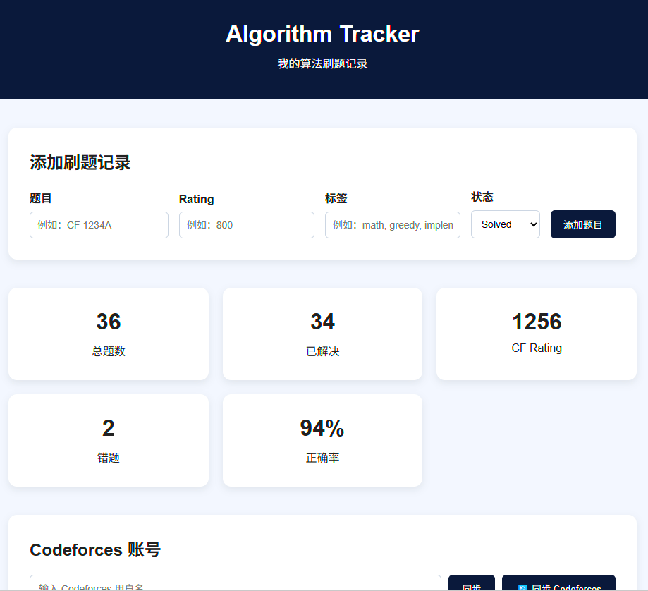
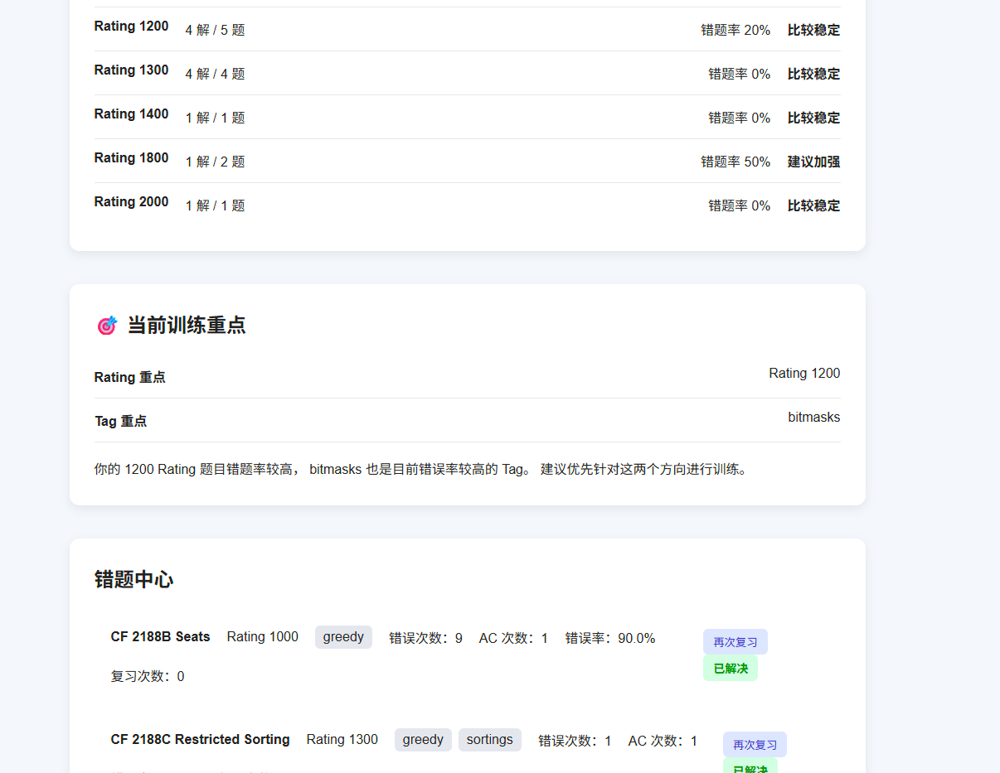
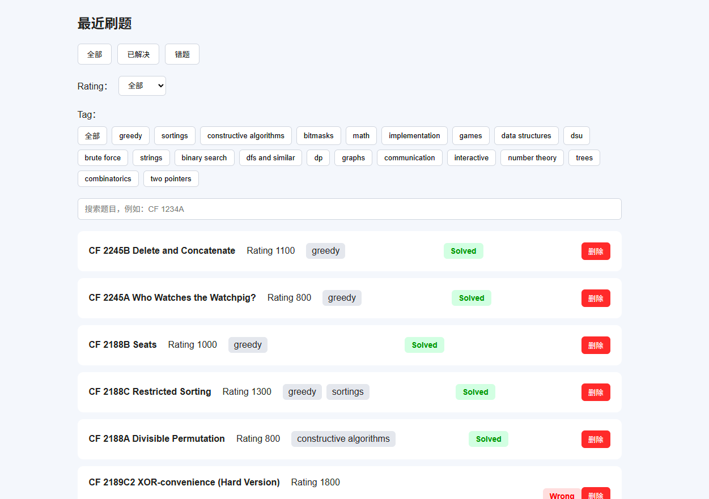

# Algorithm Tracker

> A personal Codeforces problem tracking and analysis tool.  
> 一个用于记录和分析 Codeforces 刷题数据的个人项目。

[](https://zywoo623.github.io/algorithm-tracker/)
[](https://github.com/ZywOo623/algorithm-tracker)

---

## 📌 Introduction / 项目简介

Algorithm Tracker is a lightweight web application for tracking and analyzing Codeforces problem-solving activity.

Algorithm Tracker 是一个轻量级的 Codeforces 刷题记录与分析工具。

The project helps track solved problems, wrong submissions, problem ratings, tags, and personal training progress.

主要用于记录：

- 刷题记录
- Wrong Submission 错误提交
- Problem Rating 题目难度
- Problem Tags 题目标签
- Accepted Count 通过次数
- Error Rate 错误率
- Personal Training Progress 个人训练情况

---

## ✨ Features / 功能

### Codeforces Integration

- Sync Codeforces user information
- Sync Codeforces submission history
- Analyze submission records
- Support different Codeforces handles

### Problem Tracking

- Problem list
- Rating classification
- Problem tags
- Accepted count
- Wrong submission count
- Error rate
- Problem status

### Training Analysis

- Tag statistics
- Wrong problem tracking
- Error rate analysis
- Training focus analysis
- Personal problem history

### Local Data

- LocalStorage persistence
- Independent data for different Codeforces handles
- No backend required

---

## 🖥️ Screenshots / 项目截图

### Homepage / 首页



### Data Analysis / 数据分析



### Problem List / 题目列表



---

## 🛠️ Tech Stack / 技术栈

- HTML
- CSS
- JavaScript
- Codeforces API
- LocalStorage

---

## 📂 Project Structure / 项目结构

```text
algorithm-tracker/
│
├── index.html
├── style.css
├── script.js
│
├── home.png
├── analysis.png
├── problems.png
│
└── README.md
```
## ⚙️ How It Works / 工作原理

The application uses the Codeforces API to retrieve a user's submission history.

项目通过 Codeforces API 获取用户的提交记录。

The data is processed locally and used to calculate statistics for each problem.

程序会在本地处理数据，并统计每道题目的相关信息：

Problem
├── Rating
├── Tags
├── Accepted Count
├── Wrong Count
├── Error Rate
└── Status

The processed data is stored in the browser using LocalStorage.

处理后的数据使用 LocalStorage 保存在浏览器本地。

## 🚀 Live Demo / 在线体验

**Website:**

https://zywoo623.github.io/algorithm-tracker/

---

## 📈 Current Status / 当前状态

The project is currently a frontend-based personal tool.

目前项目是一个纯前端个人工具。

It does not require a backend or database.

当前不需要后端服务器和数据库。

The project will continue to evolve as I learn more about algorithms and software development.

随着后续学习，我会继续完善项目的数据分析、可视化和训练功能。

---

## 🗺️ Roadmap / 后续计划

### Completed / 已完成

- [x] Codeforces user synchronization
- [x] Submission synchronization
- [x] Problem tracking
- [x] Rating classification
- [x] Tag statistics
- [x] Wrong submission analysis
- [x] Error rate analysis
- [x] LocalStorage persistence
- [x] Independent data for different handles

### Future / 后续计划

- [ ] Rating history chart
- [ ] More detailed statistics
- [ ] Training recommendations
- [ ] Better data visualization
- [ ] Backend service
- [ ] Database support
- [ ] User accounts
- [ ] More algorithm training features

---

## 💡 Motivation / 项目初衷

I built this project to combine programming practice with a real software project.

我希望把平时的算法训练和实际项目开发结合起来。

Instead of only solving problems, I wanted to build a tool that could help me understand my own training data.

相比单纯刷题，我希望通过这个项目记录自己的训练过程，并分析自己的刷题情况。

The project will continue to evolve as I learn more about algorithms, software development, and computer science.

随着对算法、软件开发和计算机科学的学习不断深入，这个项目也会持续更新。

---

## 👤 Author / 作者

**ZywOo623**

C++ · Algorithms · Competitive Programming

- GitHub: https://github.com/ZywOo623
- Codeforces: https://codeforces.com/profile/ZywOo623
- Personal Website: https://zywoo623.github.io/

---

> Building from zero.
>
> 从零开始，持续积累。
